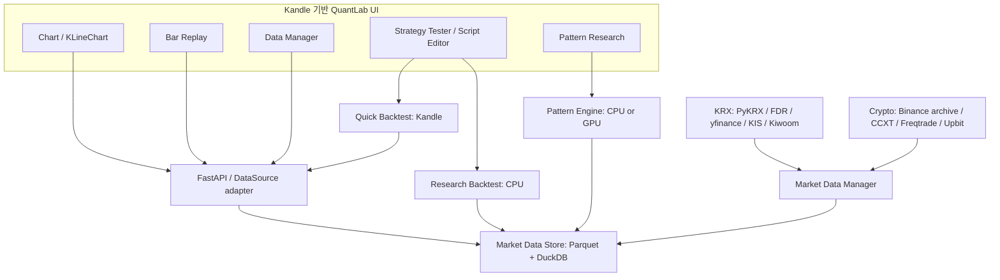
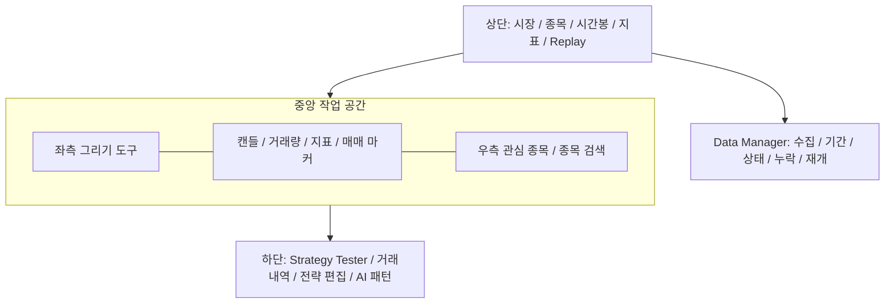

# 전체 구조 및 UI
## 설계 결정
Kandle의 브라우저 중심 데이터 관리와 독립적으로 시장 데이터를 로컬 디스크에 축적한다. 차트는 필요한 구간만 조회하고 백테스트와 연구는 전체 저장 범위에 접근한다. Kandle의 기존 DataSource 인터페이스를 어댑터로 연결한다. 기존 기능을 보존하고 점진적으로 교체한다.



## UI 레이아웃

차트 확대·축소, 십자선, 다중 패널, 추세선, 지지·저항, 피보나치, 구간 선택, 시간 동기화, 스크리너, 거래 클릭 시 해당 봉 이동을 목표로 한다. 실제 Kandle 지원 범위는 원본 테스트로 재확인한다.

## 기술 선택
기존 TypeScript/KLineChart/CodeMirror 유지. React 등 프레임워크 전환은 필수 아님. Python FastAPI, Polars, DuckDB, Parquet(ZSTD), Arrow(대량 전송), WebSocket(진행 상태/실시간 선택), Rust(병목 확인 후), Tauri(향후 선택). 별도 DB 서버 없이 로컬 우선. API는 loopback 기본, 외부 노출 시 인증 필요.

## 디렉터리 제안
```text
src/data/quantlab-source.ts
quantlab/api/
quantlab/data/{providers,storage,calendars,instruments,gaps,quality,resampling}
quantlab/backtest/
quantlab/research/
tests/
docs/windpipe/
```
Data Manager는 수집 기간, 종목, 시간봉, 저장 위치, 보유 범위, 정상 공백, 누락, 재시도, 취소/재개, 검증, 내보내기 및 삭제 기능을 제공한다. 삭제 시 스냅샷 참조 여부 확인.
