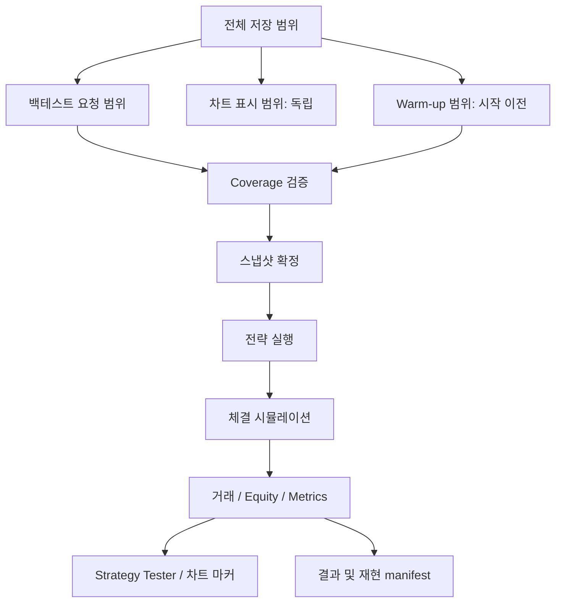
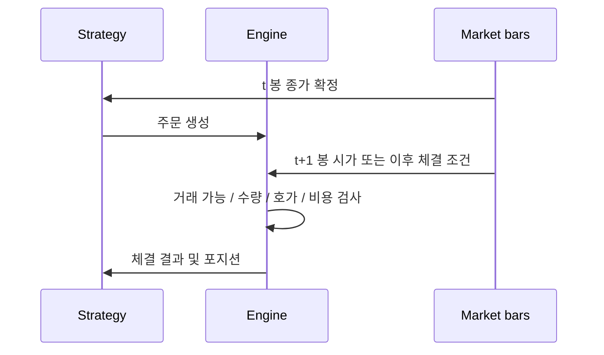
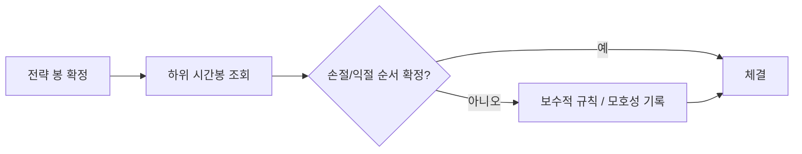
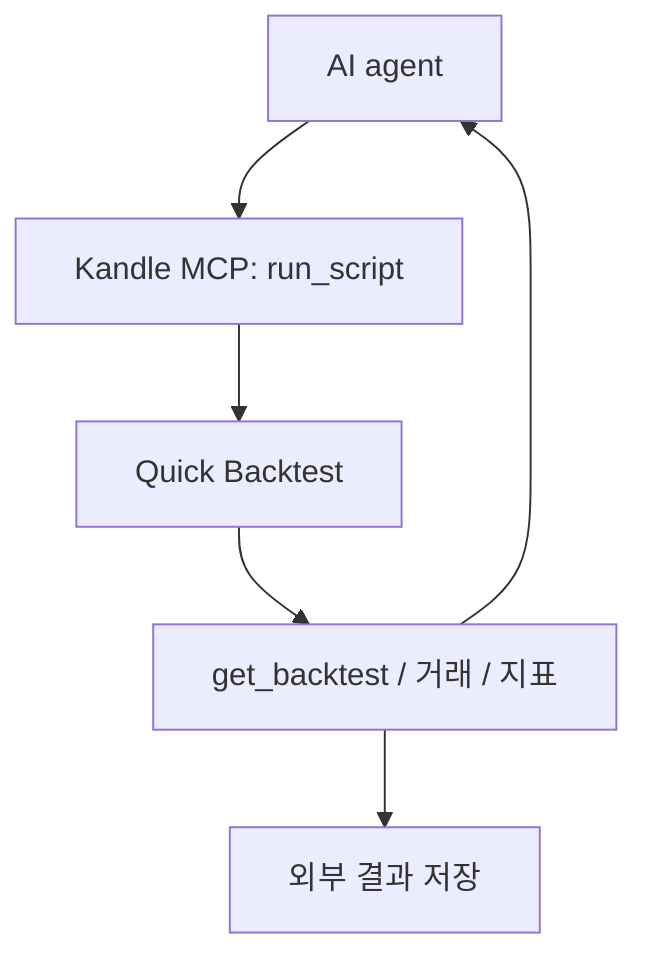

# 백테스트 엔진과 실행 계약
## Kandle 조사 결과 (공개 문서 기반, 실행/소스 정밀 감사 미완료)
Kandle은 차트, Replay, Pine 유사 언어 Lexer/Parser/Runtime, 전략 주문과 포지션, 수수료/슬리피지, 손절/익절, 자산곡선과 거래 내역, MCP를 제공하는 것으로 조사했다. 시장가 다음 봉 시가 체결, 지정가/스톱, trailing, pyramiding, OCA, 분할 청산, 리스크 제한 및 request.security 등은 테스트로 확인할 항목이다. Pine 전체 호환은 아님. 틱/호가 체결, 증거금/강제청산, 대량 포트폴리오, 최적화 및 walk-forward는 별도 구현/검증 대상. 브라우저 저장 한계(이전 조사 약 2.5MB/데이터셋, 4MB 전체, 약 4만 봉)는 버전별 확인 필요. MCP 도구 수/반환 한도 역시 소스 확인 필요.
원본: https://github.com/Kernel-Hunter/kandle ; https://kernel-hunter.github.io/kandle/

## 엔진 선택
| 엔진 | 용도 |
|---|---|
| Kandle | 차트 위 즉시 전략 검증 |
| Freqtrade | 암호화폐 수집 및 전략 검증 |
| VectorBT | 대량 벡터 연산/파라미터 탐색, 라이선스 확인 |
| Backtrader / Backtesting.py | 일반 이벤트/간단 전략 |
| LEAN / NautilusTrader / HftBacktest | 정밀 체결 또는 연구 확장 |
참고 https://github.com/polakowo/vectorbt ; https://github.com/QuantConnect/Lean ; https://github.com/nautechsystems/nautilus_trader ; https://github.com/mementum/backtrader ; https://github.com/kernc/backtesting.py .
CPU, RAM, SSD 우선. 병렬 종목/전략 실행, Numba/Polars/Optuna 후보; Rust는 병목 검증 후. GPU는 선택적 딥러닝.

## 요청 설정
시장/거래소, 종목(들), 전략 시간봉, 시작/종료 년월일시분(시간대 포함), 세션, warm-up, 수정주가 정책, 결측 정책. 별도 체결 시간봉, 초기 자본/통화, 수수료/세금/슬리피지, 주문 정책, 전략 버전/파라미터.
```json
{"data":{"market":"KRX","symbols":["005930"],"timeframe":"5m","start":"2025-01-02T09:00:00+09:00","end":"2025-12-31T15:30:00+09:00","timezone":"Asia/Seoul","session":"regular","warmup_bars":200,"price_adjustment":"raw","missing_data_policy":"error"},"execution":{"fill_timeframe":"1m","initial_capital":10000000,"currency":"KRW","commission_pct":0.015,"slippage_ticks":1},"strategy":{"id":"ema_crossover","parameters":{"fast_period":20,"slow_period":60}}}
```
예시 수수료. commission_pct 단위는 퍼센트로 명시. 종료는 exclusive, 시작/종료에 걸친 불완전 봉은 기본 제외. 캔들 시작/종료 기준과 전략이 볼 수 있는 시각 구분.


Warm-up에서는 지표 계산만, 주문 금지. Single Symbol, Multi Symbol(독립 자본), Market Scan, Portfolio(공유 자본), Multi Period, Walk-forward 구분.

## 체결

같은 봉 내 손절·익절 동시 도달은 OHLC만으로 순서 불명. Kandle의 경로 가정 검증 후 명시; 5m/15m/1h/1d 전략에 1m Bar Magnifier를 추가한다. 1m도 틱 순서를 확정 못하므로 보수적 우선순위 또는 불확실성 기록. 미래 데이터 참조 금지, synthetic 봉 체결 금지. 거래정지, KRX 호가/정수수량/세금/세션, 암호화폐 수량 정밀도/펀딩(선물), 거래비용 적용. 상장폐지 포함 및 survivorship bias 방지.


성과: 순수익률, MDD, 승률, Profit Factor, Sharpe(연율 기준 명시), equity, Buy & Hold, 거래 목록. 데이터/coverage/캘린더/전략/엔진 버전 및 파라미터, 비용, 시드 저장. 전략 결과 비교는 동일 체결 정책에서 수행.

## MCP 및 전략 예

set_symbol, set_timeframe, get_candles, get_chart_state, run_script, get_backtest, add_indicator, draw, start_replay, step_replay, screenshot, set_layout 등의 실제 계약과 한도를 테스트한다.
Pine 유사 예: fast=ta.ema(close,20), slow=ta.ema(close,60), crossover 시 strategy.entry, crossunder 시 strategy.close. 지원 문법 및 결과 일치 검증 필요. 외부 Python 전략은 신뢰 코드만 실행하거나 격리한다.
