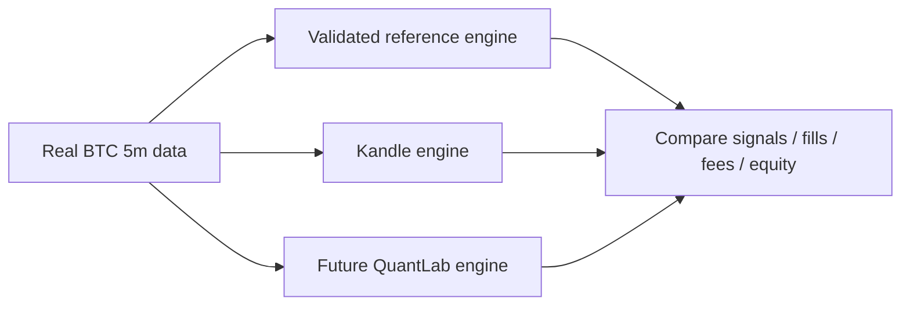

# Baseline #001 — BTC triple SMA

Status: real Binance run completed 2026-11-24; independent Kandle parity verified.
- Binance BTC/USDT spot, 5-minute candles.
- Interval [2026-11-01 00:00 KST, 2026-11-24 00:00 KST), equivalent [2026-10-31 15:00 UTC, 2026-11-23 15:00 UTC). Expected 6624 bars plus 60 pre-start warm-up bars for a continuous market.
- SMA 5, 20, 60 on closed candle closes. Long-only; flat and SMA5>SMA20>SMA60: buy. Holding and SMA5<SMA20<SMA60: sell. Otherwise hold. Evaluate after close; execute at next bar open only inside interval. Warm-up no orders. No shorts.
- Initial cash 10000 USDT. Use all available cash including fees, 0.1% fee each side, zero slippage for baseline. Explicitly record quantity rounding convention. End open positions marked to final close, no forced liquidation. Buy-and-hold benchmark with comparable fees and valuation.
- Download real public Binance candles using API/archive; page, cache, deduplicate, validate timestamps and OHLCV, report missing or unresolved intervals. Do not silently fill gaps. Prototype cache does not replace production Coverage Map. Store data/results outside repo (E:/QuantLabData), include source/time/hash and strategy version in report.
- Output summary.json, trades.csv, equity.csv; net return, final equity, maximum drawdown, completed trades, win rate, profit factor, buy-and-hold return. Undefined metrics recorded as null, not invented.
- Test reference engine first using deterministic fixtures; compare later Kandle and QuantLab engine signals, fills, fees and equity against identical inputs. Actual measured results are recorded below.

## Measured result — 2026-11-24

6,684 actual rows (6,624 execution + 60 warm-up), no missing slots, duplicate
timestamps, invalid OHLCV or synthetic rows. Seven Binance REST responses retained
with UTC request bounds, checked time and SHA-256. Repeat collection made zero
requests. Snapshot `f666fe998fb14aaea8370c9b00bcf488`, Parquet SHA-256
`174b63684e420566e55b07636bb036c8e9fe9203b3fb1c535427a196fabc3b6e`.

| Metric | Actual reference result |
|---|---:|
| Final equity | 7,814.337042 USDT |
| Net return | -21.856630% |
| Maximum drawdown | 25.480357% |
| Completed trades | 58 |
| Winning completed trades | 15.517241% |
| Profit factor | 0.229889 |
| Fees paid | 1,057.038411 USDT |
| Buy-and-hold return | -18.862966% |

An open position of 0.12424345838020328 BTC remains marked to final close.
Quantity uses 38-digit fractional Decimal, no lot rounding. All 117 fills and
6,624 execution equity values match the existing Kandle engine within tested
floating-point tolerance using cash-inclusive fee sizing. Kandle's default
buy/hold benchmark differs; the reference benchmark is entry-open plus fee.

Reproduction: `python -m quantlab.cli --data-root E:/QuantLabData baseline --collect`.
Artifacts: `E:/QuantLabData/backtest_results/baseline_001_f666fe998fb14aaea8370c9b00bcf488/`
(`summary.json`, `trades.csv`, `equity.csv`), outside Git. See ENGINE_RUNBOOK.md.
