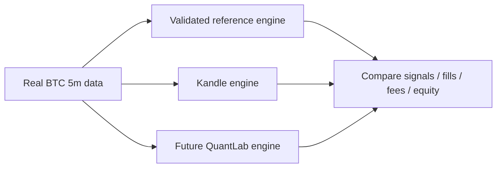

# Baseline #001 — BTC triple SMA

Status: specified, actual market data run pending. No real return metrics available.
- Binance BTC/USDT spot, 5-minute candles.
- Interval [2026-11-01 00:00 KST, 2026-11-24 00:00 KST), equivalent [2026-10-31 15:00 UTC, 2026-11-23 15:00 UTC). Expected 6624 bars plus 60 pre-start warm-up bars for a continuous market.
- SMA 5, 20, 60 on closed candle closes. Long-only; flat and SMA5>SMA20>SMA60: buy. Holding and SMA5<SMA20<SMA60: sell. Otherwise hold. Evaluate after close; execute at next bar open only inside interval. Warm-up no orders. No shorts.
- Initial cash 10000 USDT. Use all available cash including fees, 0.1% fee each side, zero slippage for baseline. Explicitly record quantity rounding convention. End open positions marked to final close, no forced liquidation. Buy-and-hold benchmark with comparable fees and valuation.
- Download real public Binance candles using API/archive; page, cache, deduplicate, validate timestamps and OHLCV, report missing or unresolved intervals. Do not silently fill gaps. Prototype cache does not replace production Coverage Map. Store data/results outside repo (E:/QuantLabData), include source/time/hash and strategy version in report.
- Output summary.json, trades.csv, equity.csv; net return, final equity, maximum drawdown, completed trades, win rate, profit factor, buy-and-hold return. Undefined metrics recorded as null, not invented.
- Test reference engine first using deterministic fixtures; compare later Kandle and QuantLab engine signals, fills, fees and equity against identical inputs. Actual run pending, no invented data/results.

