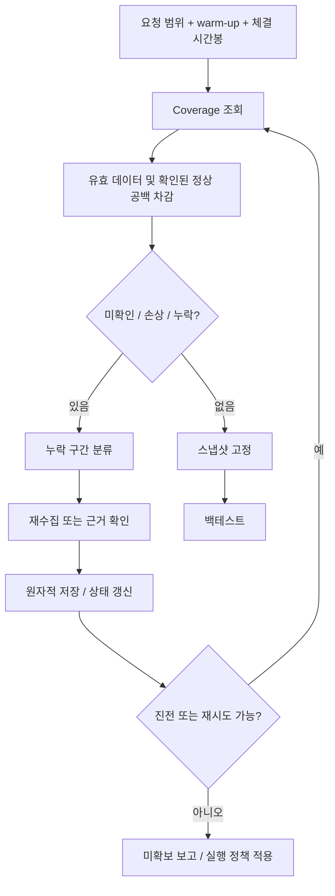
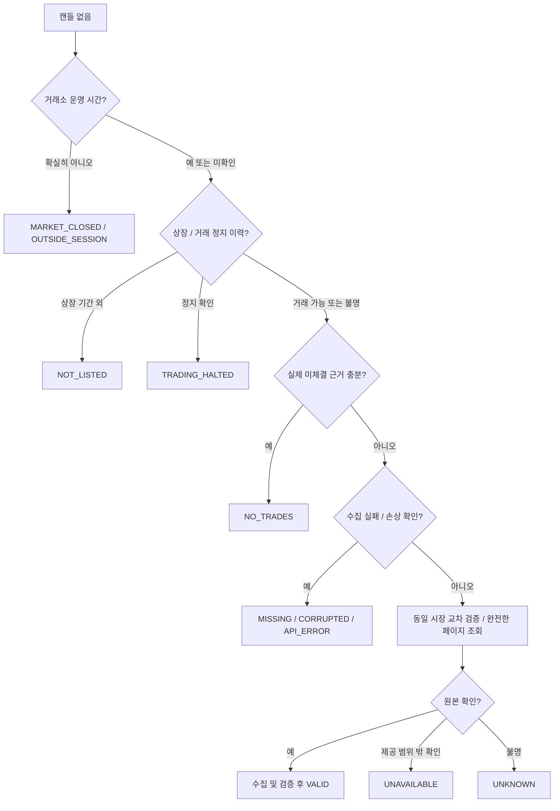

# Coverage Map 및 데이터 무결성
## 결정
캔들이 존재하지 않는 이유까지 저장한다. 실제 OHLCV와 Coverage Map은 분리한다. 정상 공백에 가짜 OHLCV를 넣지 않는다. 모든 구간은 반열린 [start,end) UTC 범위로 정의한다. 미등록 구간은 UNKNOWN. 겹치지 않는 연속 상태 구간을 압축 저장하고 인접 동일 상태를 병합한다. 거래소 캘린더는 공통으로 참조하여 종목별 휴장 복제 비용을 줄일 수 있다.

## 상태 코드
| 상태 | 의미 | 재수집 |
|---|---|---|
| VALID | 캔들 검증 및 저장 | 아니오, 정정/재검증 예외 |
| MARKET_CLOSED | 거래소 휴장 확인 | 아니오 |
| OUTSIDE_SESSION | 거래 세션 외 | 아니오 |
| NOT_LISTED | 상장 이전/폐지 이후 | 아니오 |
| TRADING_HALTED | 거래 정지 확인 | 아니오 |
| NO_TRADES | 미체결 확인 | 아니오 |
| MISSING | 수집 누락 | 예 |
| CORRUPTED | 손상/불일치 | 예 |
| API_ERROR | 조회 실패 | 재시도 |
| UNAVAILABLE | 공급원 제공 불가 | 대체 공급원/정책 변경 시 |
| UNKNOWN | 근거 부족 | 조사 |
| PROVISIONAL | 미완성 캔들 | 마감 후 갱신 |
정상 공백과 UNAVAILABLE은 다르다. API 빈 응답만으로 NO_TRADES를 판정하지 않는다.

## 분류 순서도

거래소 운영 일정은 exchange_calendars XKRX 및 공식 공지/예외를 사용한다. 수능일·연말·임시 휴장·과거 거래시간 변경 포함. Instrument Master는 종목 고유 ID, 상장/폐지, 코드 변경, 거래정지 및 상태 이력 보관. 암호화폐는 거래소 운영 장애와 상장/폐지, 공급원의 무거래 봉 정책 고려. 업비트는 미체결 봉이 생성되지 않으므로 요청 범위 전체의 성공적 페이지네이션 및 근거 확보 필요.
참고: https://github.com/gerrymanoim/exchange_calendars ; https://docs.upbit.com/

## 저장 모델
coverage_intervals: instrument_id, timeframe, data_series_id, start_utc, end_utc, status, reason, evidence_id, provider, calendar_version, revision, checked_at, retry_count, next_retry_at.
evidence: 조회 범위/완료 여부, 응답 코드/해시, 공지 URL, 확인 시각, 판정 규칙 버전.
manifest: 파일 경로, 행 수, min/max, 체크섬, revision. 상태 이력은 보존. 동일 구간 동시 요청은 single-flight 또는 잠금으로 중복 작업 방지. 파일 삭제/변경 시 VALID 재검증. 실패는 제한된 재시도 및 backoff, 공급원별 쿨다운; 무한 반복 금지.

## 예시
요청 2020~2026, 기존 2021~2024, 중간 2023-06 누락: 2020, 2023-06, 2025~2026만 요청한다. 휴장 및 정지 등 확인된 구간 제외.

## 무결성 지표
상태 판명률 = (VALID + 확인된 정상 공백 + 근거 있는 확보 불가)/검사 슬롯. 백테스트 준비율 = (VALID + 확인된 정상 공백)/검사 슬롯. 별도로 캔들 값 유효성, 체크섬, 시간 정렬, 중복, OHLC 관계, 거래량, 세션 및 종목 상태 검사. 분모와 상태별 개수를 함께 표기. 확보 불가를 준비 완료로 계산하지 않는다.
Strict: 필요한 범위의 미확인/손상/확보 불가가 있으면 중지. Warning: 사용자 동의 및 결과 경고. Segment: 검증된 연속 구간별 독립 실행, 포지션 이어붙이지 않음. Warm-up 별도 검사.
NO_TRADES에 한해 필요시 이전 종가 OHLC, V=0인 synthetic bar를 파생 뷰에 생성; is_synthetic=true, 실제 체결 금지. 휴장 및 UNKNOWN을 임의 채우지 않는다.

## Data Manager 화면 설계
기간별 상태 지도(녹색 VALID, 회색 휴장/정지, 파랑 미체결, 빨강 누락, 주황 확보 불가), 상태별 필터, 근거 열람, 선택 범위 재검증/재수집, 진행률, 작업 중지/재개, 데이터 버전/공급원 표시. 숫자는 실제 DB에서 계산한다.
