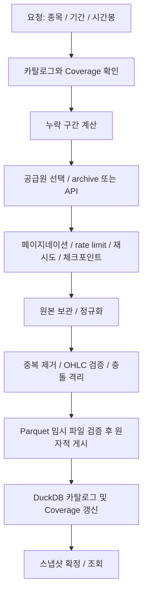
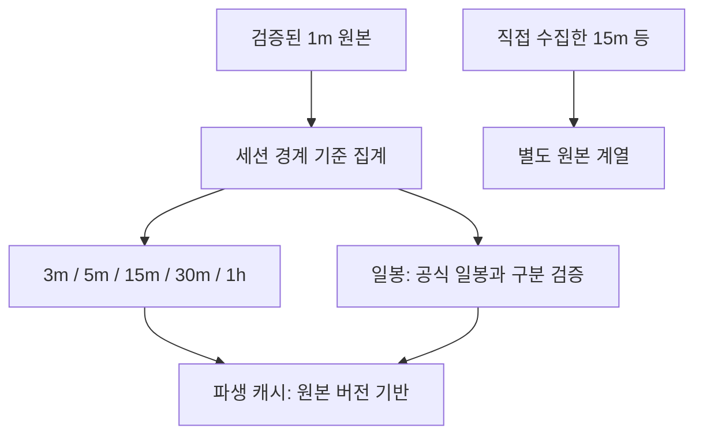

# 시장 데이터 수집 및 저장
## 공급원 비교
| 공급원 | 시장 | 시간봉 | 인증/제약 |
|---|---|---|---|
| PyKRX / FinanceDataReader | 한국 주식 | 일봉 및 부가 정보 | API 키 불필요, KRX 로그인 필요 가능 |
| yfinance | 한국 주식 등 | 1m/5m/15m/일봉 | 공개 조회, 분봉 기간 제한 |
| tvDatafeed | 한국 주식 등 | 분봉/일봉 | 비공식 TradingView, 조회량/약관 제약 |
| Kiwoom REST / pykiwoom / KOAPY | 한국 주식 | 틱/분봉/일봉 | 계좌 및 인증, 과거 범위 실측 필요 |
| KIS / python-kis | 한국 주식 | 분봉/일봉 | API 키, 공식 예제의 과거 분봉 제약 확인 |
| Binance Public Data | 암호화폐 | 장기간 분봉/일봉 | 공개 월별/일별 파일 |
| CCXT / Freqtrade | 암호화폐 | 분봉/일봉 | 공개 시세는 일반적으로 키 불필요 |
| Upbit candle API | 암호화폐 | 분봉/일봉 | 공개 조회, 요청당 제한, 미체결 봉 생략 |
공급원별 최신 정책, 실제 조회 가능 기간, 이용/재배포 조건은 구현 시 확인. MarketData 및 Creon DataReader도 참고 후보. 서로 다른 거래소의 데이터는 동일 종목명이라도 대체 불가.

## 참고 자료
- https://github.com/sharebook-kr/pykrx
- https://github.com/FinanceData/FinanceDataReader
- https://github.com/ranaroussi/yfinance
- https://github.com/rongardF/tvdatafeed
- https://github.com/yoonbae81/marketdata
- https://github.com/koreainvestment/open-trading-api
- https://openapi.kiwoom.com/
- https://github.com/ccxt/ccxt
- https://www.freqtrade.io/en/stable/data-download/
- https://data.binance.vision/
- https://github.com/binance/binance-public-data
- https://docs.upbit.com/kr/docs/how-to-download-candle-data

## 수집 예제 (설계 참고, 실행 미검증)
```bash
freqtrade download-data --exchange binance --pairs BTC/USDT ETH/USDT --timeframes 1m --timerange 20200101-20261124 --data-format-ohlcv parquet
```
```python
from pykrx import stock
df = stock.get_market_ohlcv("20200101", "20261123", "005930")
import yfinance as yf
minute = yf.download("005930.KS", period="7d", interval="1m")
import ccxt
ex = ccxt.binance({"enableRateLimit": True})
bars = ex.fetch_ohlcv("BTC/USDT", "1m", since=ex.parse8601("2024-01-01T00:00:00Z"), limit=1000)
```
CCXT 예제는 1회 요청; 페이지네이션, 오류 처리, 범위 검증 필요.

## 수집 파이프라인


## 저장
설정 가능한 루트 예: D:/QuantLabData/{catalog,raw,ohlcv,features,backtest_results,models,logs}. 시장/종목/시간봉/연월 파티션. 작은 파일은 압축 병합. 원본과 가공 구분, 파일 체크섬 및 manifest 버전 기록. 단일 writer 및 잠금, 임시 파일과 카탈로그 트랜잭션/복구 절차로 중단 시 일관성 유지. Git에는 데이터나 인증정보 금지.
공통 캔들: instrument_id, exchange, symbol, timeframe, bar_start_utc, bar_end_utc, open/high/low/close, volume, turnover(nullable), currency, adjustment, source, revision, is_final, is_synthetic. 가격 정밀도/호가단위 보존. 시간은 UTC, UI는 Asia/Seoul 등 선택. 키는 종목 고유 ID/시간봉/시작 시각/가격 조정 방식/데이터 계열; 공급원별 원본과 정규화본 분리. 중복 충돌은 조용히 덮어쓰지 않는다.
일봉 수정주가와 비수정주가, 기업행사(분할/배당) 별도 관리.

## 시간봉 합성

O=첫값,H=max,L=min,C=마지막,V=sum. 휴장/세션 경계 및 미확인 공백 반영. 15m에서 1m 역생성 금지. 원본 변경 시 영향받는 파생 캐시 무효화.

## 용량 추정
5년 1m 기준 암호화폐 100종목 약 2.63억 봉, 한국 주식 2500종목 약 12.29억 봉(252 거래일/년, 390분/일 가정). 압축 25~50 bytes/bar 가정 시 약 6.6~13.2GB 및 30.7~61.4GB. 실측 아님. RAM/CPU/NVMe 중심, GPU 불필요.
