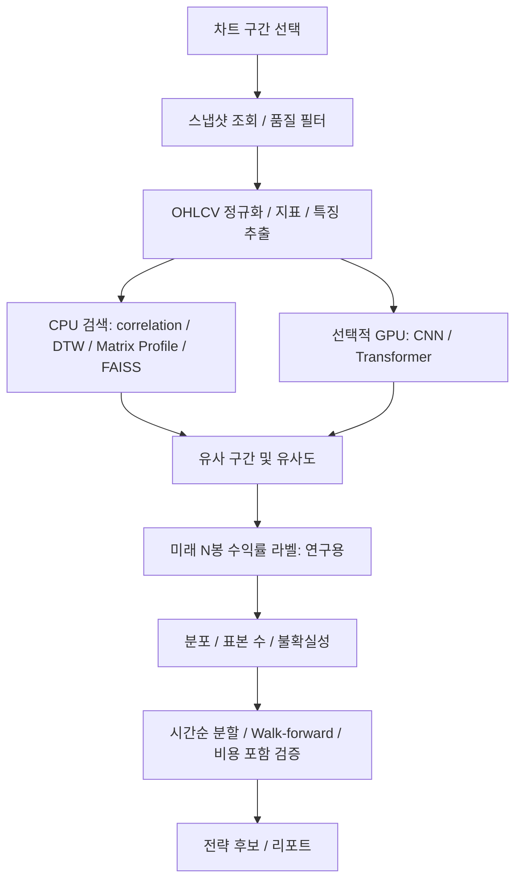

# AI 패턴 연구
차트 영역을 선택하여 전체 종목/기간에서 유사 패턴을 검색하고 이후 수익률 분포를 분석한다. 기존 패턴 분류 외 신규 패턴 탐색도 목표. 결과는 예측 보장 아님.

원본 가격과 정규화 특징 분리. 학습/검증/테스트 시간순 분리, 겹치는 윈도와 라벨 구간 누수 방지, 동일 구간 중복 검색 제외, 검색 시점 이후 정보 사용 금지. 전체 시장 분석은 상장 이력 포함. 모델은 데이터 버전/특징 버전/시드와 함께 저장. CPU 기반 DTW/Matrix Profile부터 시작하고 필요 시 RTX 3090 등 GPU 활용.
