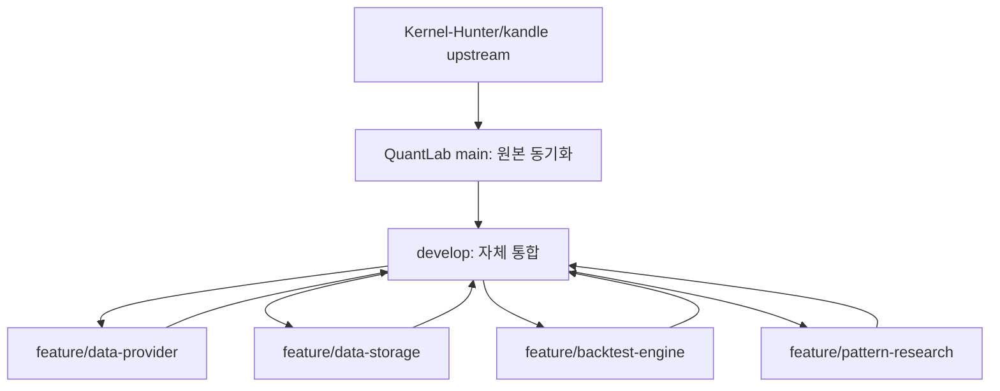

# QuantLab — 개발 설계 기준
2026-11-24 | windpipe/QuantLab | develop

Kandle의 TradingView 스타일 UI, KLineChart, 전략 언어, Replay, Strategy Tester, MCP를 재사용하고 한국 주식과 암호화폐용 독립 Market Data Engine을 구축한다. CPU 백테스트 우선, GPU는 선택적 AI 학습에만 사용한다. 원본 MIT 라이선스와 저작권 표시 유지. 이 문서는 설계이며 실제 구현/성능 검증 완료를 의미하지 않는다.

## 문서
- [전체 구조 및 UI](ARCHITECTURE.md)
- [수집 및 저장](DATA.md)
- [Coverage Map 및 무결성](COVERAGE.md)
- [백테스트](BACKTEST.md)
- [AI 패턴 연구](PATTERN.md)
- [개발 로드맵](ROADMAP.md)

## 브랜치

원본 main에는 자체 변경을 넣지 않는다. develop에서 기능 브랜치를 만들고 테스트 후 PR로 병합한다. 공개 저장소에는 API 키, 실제 시장 데이터, 비공개 전략 및 개인정보를 넣지 않는다.
